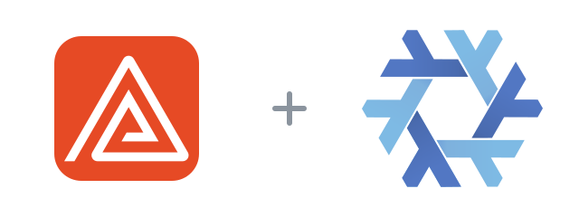

<p align="center">
  
</p>

<p align="center">
  <a href="https://delta.dev"></a>
  <a href="https://nixos.org"></a>
  <a href="LICENSE"></a>
</p>

# Delta for Nix

A Nix flake for the Linux build of [Delta](https://delta.dev), Zed's multiplayer environment for coding with agents and reviewing their work.

It packages the official binary archive, installs its desktop entry and icons, and exposes both NixOS and Home Manager modules. It now follows Zed's official [delta-nix](https://github.com/zed-industries/delta-nix) release pins on x86_64 and ARM64 Linux. Nix downloads the official public release archives automatically.

## Install

```console
nix run github:Fractal-Tess/delta-flake
```

No manual archive import is needed. A daily workflow refreshes the upstream pin and validates the package. Pushes, pull requests and successful updater runs trigger native builds on both supported Linux architectures.

For NixOS, add the flake input and module, then enable it:

```nix
{
  inputs.delta-flake.url = "github:Fractal-Tess/delta-flake";

  imports = [ inputs.delta-flake.nixosModules.default ];
  programs.delta.enable = true;
}
```

The same option is available through `homeManagerModules.default`.

## Verify

```console
nix flake check
nix run . -- --version
```

The installed command is `zed-delta`, avoiding a collision with the unrelated `delta` Git diff pager in nixpkgs. The desktop launcher remains named **Delta**.

The Delta mark is from [Zed Industries](https://delta.dev/brand). The Nix snowflake is by Simon Frankau and Tim Cuthbertson under [CC BY 4.0](https://github.com/NixOS/nixos-artwork/blob/master/LICENSE). The marks were resized and arranged; this project is not endorsed by either project.
